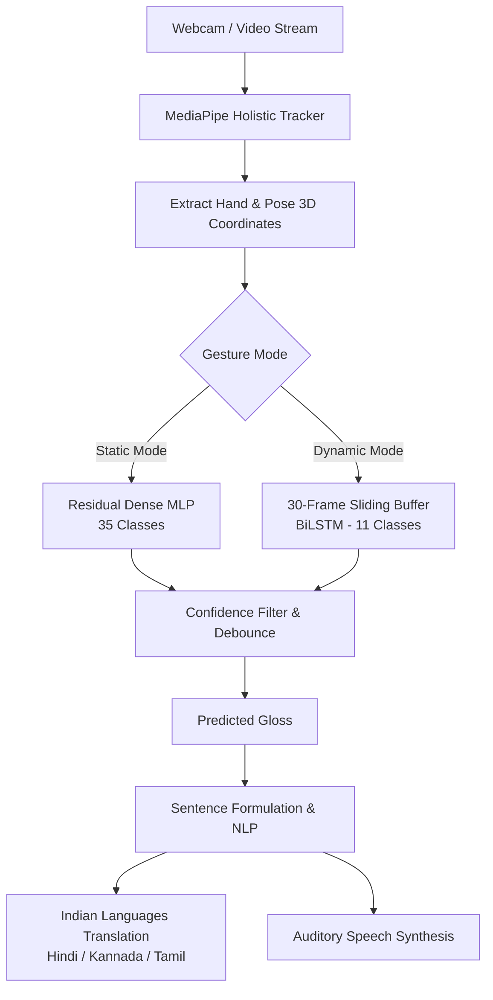

# 🤟 Indian Sign Language (ISL) to Text Translation Studio (V3)

[](https://isl-translation-studio.onrender.com/)
[](https://www.python.org/)
[](https://fastapi.tiangolo.com/)
[](https://www.tensorflow.org/)
[](https://mediapipe.dev/)
[](https://react.dev/)

An end-to-end, real-time vision platform that translates **Indian Sign Language (ISL)** gestures into natural language text and multi-lingual regional translations. 

🔗 **Live Production Web Studio:** [https://isl-translation-studio.onrender.com/](https://isl-translation-studio.onrender.com/) 

Equipped with a **Decoupled Dual-Engine Architecture** capable of classifying both static single-frame hand signs and complex temporal dynamic phrases across 46 total classes.

---

## 🌟 Key Features

* **⚡ Real-Time Decoupled Dual-Engine (V3):**
  * **Static Engine:** High-capacity Residual Dense MLP predicting **35 static classes** (Alphabets $A-Z$, Numerals $0-9$, common gestures) from normalized 21-point hand coordinates.
  * **Dynamic Engine:** Multi-layer Bidirectional LSTM (BiLSTM) tracking **11 dynamic temporal words** over 30-frame sliding windows (e.g., *Hello*, *Thank You*, *Sorry*, *Please*, *Welcome*, *Congratulations*).
* **🌐 Web Translation Studio:**
  * Modern, responsive React + Vite web application.
  * Low-latency WebSocket video streaming and client-side camera access.
  * Real-time HUD showing confidence meters, bounding boxes, hand landmark meshes, and sign gloss history.
  * Built-in interactive **Sign Glossary** and reference guides.
* **🇮🇳 Multi-Lingual NLP & Speech Engine:**
  * Translates recognized sign sequences into grammatically sound sentences in English and Indian regional languages (Hindi, Kannada, Tamil, Telugu, etc.).
  * Native Text-to-Speech (TTS) auditory playback.
* **🖥️ Standalone Desktop HUD:**
  * OpenCV-based low-latency native camera window with DirectShow hardware acceleration.

---

## 🏗️ System Architecture



---

## 📊 Supported ISL Vocabulary (46 Classes)

| Category | Count | Classes |
| :--- | :---: | :--- |
| **Static Alphabets** | 24 | `A`, `B`, `C`, `D`, `E`, `F`, `G`, `I`, `K`, `L`, `M`, `N`, `O`, `P`, `Q`, `R`, `S`, `T`, `U`, `V`, `W`, `X`, `Y`, `Z` |
| **Static Numerals** | 10 | `0`, `1`, `2`, `3`, `4`, `5`, `6`, `7`, `8`, `9` |
| **Static Signs** | 1 | `Good` |
| **Dynamic Words** | 11 | `Hello`, `ThankYou`, `Sorry`, `Please`, `Yes`, `No`, `Welcome`, `Congrats`, `Claps`, `H`, `J` |

---

## 🚀 Quickstart Guide

### Prerequisites
* Python 3.10 (recommended)
* Node.js 18+ (only needed if building or customizing the frontend)

### 1. Installation

```bash
# Clone the repository
git clone https://github.com/EpicS9/ISL-To-Text-With-Native-Language-Translation.git
cd ISL-To-Text-With-Native-Language-Translation

# Create and activate virtual environment
python -m venv isl_env
# On Windows:
isl_env\Scripts\activate
# On Linux/macOS:
source isl_env/bin/activate

# Install dependencies
pip install -r requirements.txt
```

### 2. Running the Application

#### Option A: Web Translation Studio (Recommended)
Launch the FastAPI server which serves the pre-compiled React frontend:

```bash
# Windows 1-Click:
run_translation_studio.bat

# Or via Command Line:
python -m uvicorn server:app --host 127.0.0.1 --port 8000
```
Open your browser and navigate to **`http://127.0.0.1:8000`**.

#### Option B: Standalone Desktop OpenCV HUD
If you prefer running a direct native desktop window:

```bash
# Windows 1-Click:
run_realtime_v3.bat

# Or via Command Line:
python realtime_isl_translator_v3.py
```
* **Hotkeys:**
  * `TAB` or `M`: Toggle between Static and Dynamic recognition modes.
  * `C`: Clear sentence buffer.
  * `Q` or `ESC`: Exit.

---

## 📦 Dataset Access

The comprehensive multi-signer dataset (~9.76 GB) consists of raw RGB frames, extracted landmark coordinate arrays (`.npy`), and CVAT annotation metadata across multiple diverse lighting conditions and signers.

* **Download Dataset:** [Kaggle Dataset Link](https://www.kaggle.com/) *(Dataset upload link coming soon)*
* **Training Pipeline:** Run `ISL_Training_Colab.py` on Google Colab or any GPU instance to retrain both models from scratch.

---

## 🛠️ API Reference

| Endpoint | Method | Description |
| :--- | :---: | :--- |
| `/api/health` | `GET` | Health check & model warm-up status |
| `/api/models/info` | `GET` | Neural network architectures and metadata |
| `/api/models/glossary` | `GET` | Full list of supported signs and categories |
| `/api/cameras` | `GET` | Enumerates available physical & virtual cameras |
| `/ws/stream` | `WebSocket` | Real-time bi-directional frame inference & HUD sync |

---

## 📄 License
This project is licensed under the MIT License - see the LICENSE file for details.
